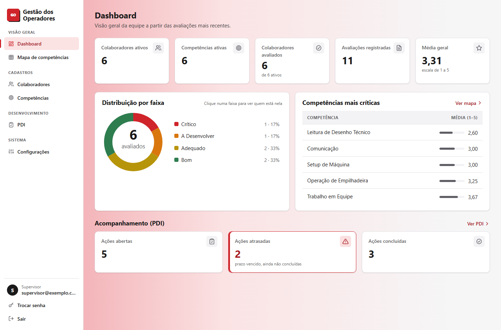
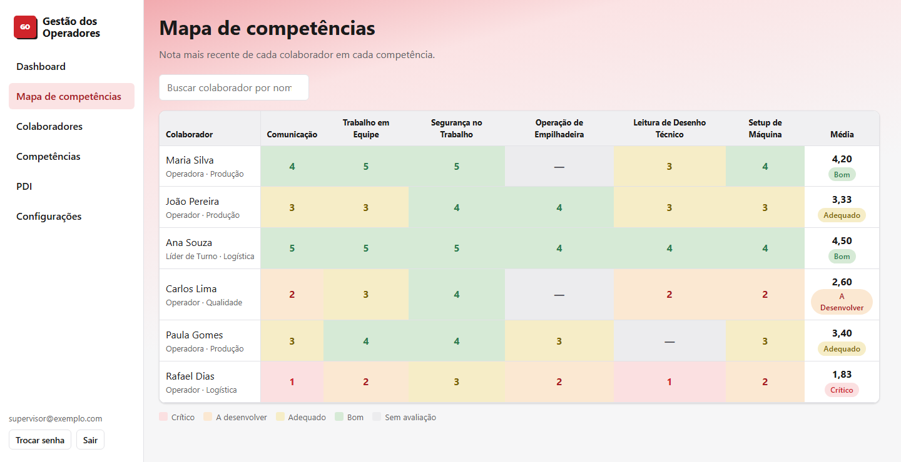
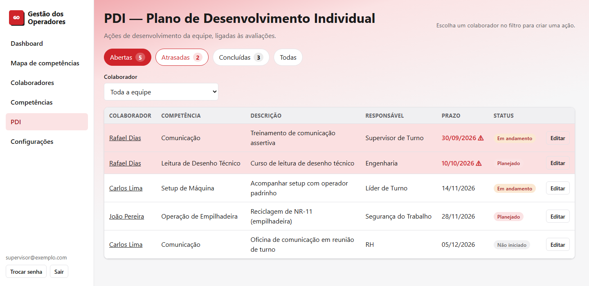
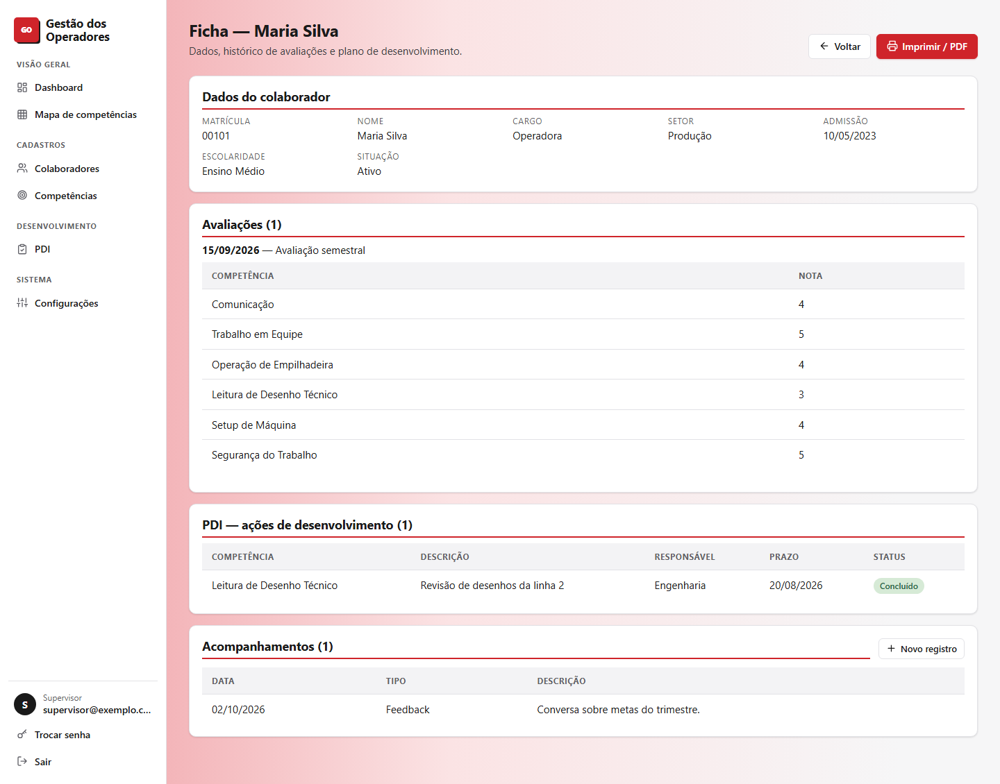
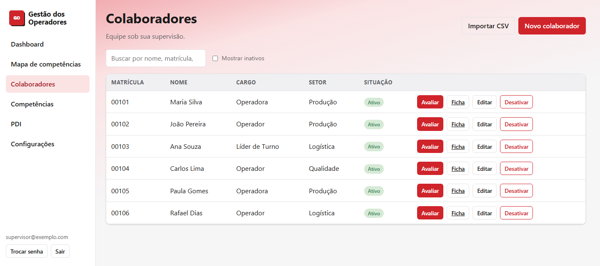
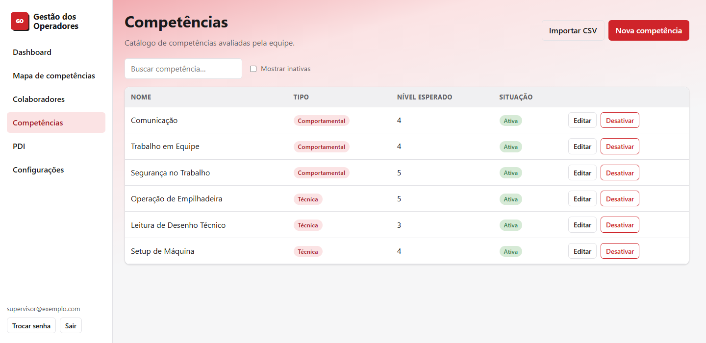
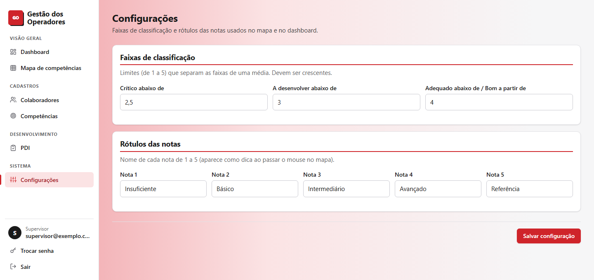
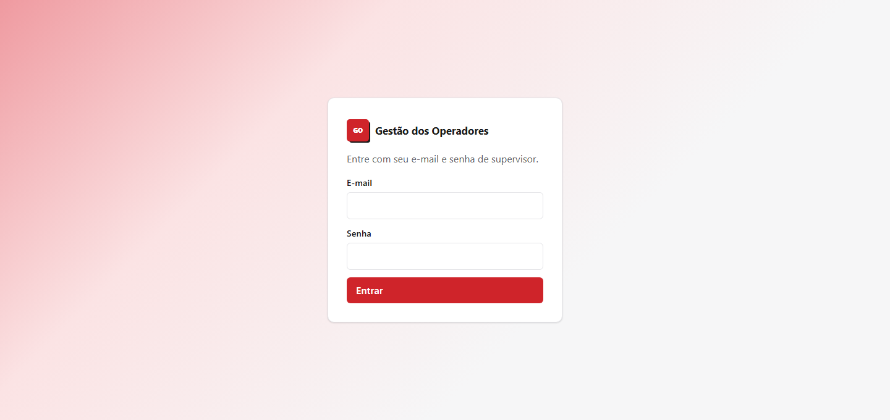

# Gestão de Competências e PDI — API

Back-end (Spring Boot 3 + PostgreSQL) do sistema do supervisor de turno.
**Entrega 1:** autenticação, colaboradores e banco de competências.
**Entrega 2:** avaliações com nota (1–5) por competência e histórico por colaborador.
**Entrega 3:** login com token JWT (substitui o HTTP Basic), mapa de competências e dashboard.
**Entrega 4:** PDI — plano de desenvolvimento individual (ações ligadas a avaliações/competências);
indicadores de PDI no dashboard; ficha do colaborador (impressão/PDF); rate limiting no login e cabeçalhos
de segurança (CSP); e melhorias de UX (toasts, confirmações, busca).
**Entrega 5:** importação de colaboradores e competências por CSV (relatório por linha).
**Entrega 6 (atual):** registros de acompanhamento por colaborador (feedback/conversa/ocorrência, na ficha)
e tela de Configurações (faixas de classificação + rótulos das notas 1–5, editáveis por supervisor).
Há um front-end em `frontend/` (Vite + React + TypeScript).

## Status

Projeto em desenvolvimento, entregue por incrementos (as "Entregas" acima). As próximas
frentes são testes automatizados cobrindo mais serviços e autenticação por cookie `HttpOnly`.

Todos os dados do repositório são **fictícios** (ver `exemplos-csv/`). Credenciais e segredos
ficam em variáveis de ambiente, fora do versionamento.

## Stack

Java 21 · Spring Boot 3.3 · Spring Security (JWT) · PostgreSQL 16 · Flyway · Maven ·
React 18 · TypeScript 5 · Vite 5 · React Router

## Telas

> Capturas com **dados fictícios** — nenhum dado real de colaborador aparece aqui.

**Dashboard** — indicadores da equipe, distribuição por faixa (clicar numa fatia filtra o mapa)
e competências mais críticas.

**Mapa de competências** — nota mais recente de cada colaborador em cada competência, com a
média e a classificação da linha.

**PDI** — plano de desenvolvimento de toda a equipe, com resumo clicável, filtro por status
e destaque das ações atrasadas.

**Ficha do colaborador** — dados, histórico de avaliações, ações de PDI e registros de
acompanhamento, em layout preparado para impressão/PDF.

Outras telas (colaboradores, competências, configurações e login)

**Colaboradores** — cadastro, importação por CSV e desativação (sem exclusão, para preservar o histórico).

**Competências** — catálogo com tipo (comportamental/técnica) e nível esperado.

**Configurações** — faixas de classificação e rótulos das notas, editáveis por supervisor.

**Login** — único endpoint público; não há cadastro aberto.

## Requisitos
- JDK 21 (o projeto não é compatível com versões mais novas, como o 26)
- PostgreSQL 16+ (instalado no Windows) **ou** Docker (`docker compose up -d`)
- VSCode com a **Extension Pack for Java** (opcionalmente a **Spring Boot Extension Pack**)

## Banco (PostgreSQL instalado)
No SQL Shell (psql), como usuário `postgres`:

    CREATE USER gestao WITH PASSWORD 'gestao_dev';
    CREATE DATABASE gestao_operadores OWNER gestao;

As tabelas são criadas pelo Flyway na primeira execução.

## Executando (VSCode)
1. Abra a pasta que contém o `pom.xml`. A extensão Java importa as dependências sozinha
   (não é preciso Maven instalado; o build e os testes rodam pela própria extensão).
2. Garanta que o projeto usa o **JDK 21** (JDK 26 não é compatível): instale o JDK 21 e
   selecione-o em *Java: Configure Java Runtime* ou na barra inferior do editor.
3. Copie `.env.example` para `.env` e preencha `ADMIN_EMAIL`, `ADMIN_PASSWORD`
   (senha com 12+ caracteres) e `JWT_SECRET` (32+ caracteres aleatórios — a app não sobe sem ele).
   O `.env` já é ignorado pelo git — não versione esses valores.
4. Rode pela aba *Run and Debug* a configuração `GestaoCompetenciasApplication`
   (ela lê o `.env`), ou use o *Spring Boot Dashboard*.
5. O log deve terminar com `Started GestaoCompetenciasApplication` e `Conta de supervisor criada`.

Para rodar os testes: abra o *Testing* (Test Explorer) e execute, ou clique em *Run Test*
na classe `AvaliacaoServiceTest`.

## Contas e login (não há cadastro público)

Só existem as contas que você provisiona pelo `.env` — de propósito, para ninguém mais se
cadastrar. Ao subir, a aplicação **cria a conta de `ADMIN_EMAIL`/`ADMIN_PASSWORD` se aquele
e-mail ainda não existir** (idempotente). Para ter duas contas:

1. Preencha o `.env` com **seus** dados de teste e suba a aplicação → cria sua conta.
2. Troque o `.env` para o **e-mail do supervisor** com uma **senha temporária** e suba de novo
   → cria a conta dele. (Reiniciar depois não recria nem sobrescreve nada.)
3. No primeiro acesso, cada um usa **Trocar senha** (na barra lateral) para definir a própria
   senha. Assim o supervisor é o único que sabe a senha dele, e você pode apagar a temporária
   do seu `.env`.

Trocar a senha não invalida tokens já emitidos; eles expiram pelo tempo normal (`JWT_EXP_MIN`).

## Testando (PowerShell)

Primeiro faça login para obter o token (JWT) e monte o cabeçalho `Bearer`:

    $login = Invoke-RestMethod -Method Post -Uri http://localhost:8080/api/sessao `
      -ContentType "application/json; charset=utf-8" `
      -Body '{"email":"seu@email.com","senha":"sua-senha"}'
    $h = @{ Authorization = "Bearer $($login.token)" }

Depois use o `$h` nas demais chamadas:

    Invoke-RestMethod -Method Post -Uri http://localhost:8080/api/competencias -Headers $h `
      -ContentType "application/json; charset=utf-8" `
      -Body '{"nome":"Comunicação","tipo":"COMPORTAMENTAL","acaoPadrao":"Treinamento de Comunicação"}'

    Invoke-RestMethod -Method Post -Uri http://localhost:8080/api/colaboradores -Headers $h `
      -ContentType "application/json; charset=utf-8" `
      -Body '{"matricula":"1001","nome":"Colaborador Teste","cargo":"OPERADOR","setor":"Injeção"}'

    Invoke-RestMethod -Uri http://localhost:8080/api/colaboradores -Headers $h
    Invoke-RestMethod -Uri http://localhost:8080/api/mapa -Headers $h
    Invoke-RestMethod -Uri http://localhost:8080/api/dashboard -Headers $h

Use apenas dados fictícios até a empresa aprovar o uso de dados reais.

## Endpoints
| Recurso | Operações |
|---|---|
| `/api/sessao` | POST (login com e-mail e senha → token JWT). Único endpoint público. |
| `/api/sessao/senha` | POST (troca a senha do supervisor logado: `senhaAtual` + `novaSenha`) |
| `/api/colaboradores` | GET (`?incluirInativos=true`), GET `/{id}`, POST, PUT `/{id}`, POST `/{id}/desativar`, POST `/{id}/reativar` |
| `/api/competencias`  | idem (`?incluirInativas=true`) |
| `/api/colaboradores/{id}/avaliacoes` | GET (histórico, mais recente primeiro), POST (nova avaliação) |
| `/api/avaliacoes/{id}` | GET, PUT (corrige a avaliação) |
| `/api/colaboradores/{id}/pdi` | GET (ações do colaborador), POST (nova ação) |
| `/api/pdi/{id}` | GET, PUT (edita a ação: descrição, prazo, status, conclusão, evidência) |
| `/api/colaboradores/{id}/acompanhamentos` | GET (registros, mais recente primeiro), POST (novo registro; apenas-acréscimo) |
| `/api/colaboradores/importar` · `/api/competencias/importar` | POST multipart (campo `arquivo`, CSV → relatório por linha) |
| `/api/mapa` | GET (colaboradores × competências com a nota atual e a classificação) |
| `/api/dashboard` | GET (indicadores: médias, distribuição por faixa, competências mais críticas) |
| `/api/configuracao` | GET, PUT (faixas de classificação e rótulos das notas 1–5 do supervisor) |

Exceto `/api/sessao`, toda chamada exige `Authorization: Bearer <token>`.

Não há exclusão: colaboradores e competências são desativados, para preservar o histórico.
Avaliações também não são excluídas; correções são feitas por `PUT`.

### Regras das avaliações
- Uma nota (1–5) por competência; a competência precisa ser do supervisor logado.
- Uma avaliação por colaborador por data (`data_avaliacao`).
- Avaliação é parcial: não é obrigatório pontuar todas as competências.
- Não se cria avaliação para colaborador inativo.

Exemplo (PowerShell, continuando do bloco anterior; `1` é o id do colaborador):

    Invoke-RestMethod -Method Post -Uri http://localhost:8080/api/colaboradores/1/avaliacoes -Headers $h `
      -ContentType "application/json; charset=utf-8" `
      -Body '{"dataAvaliacao":"2026-01-15","observacao":"Primeira avaliação","notas":[{"competenciaId":1,"nota":4}]}'

    Invoke-RestMethod -Uri http://localhost:8080/api/colaboradores/1/avaliacoes -Headers $h

## Front-end (`frontend/`)

Interface web em Vite + React + TypeScript (login, colaboradores, competências, avaliações,
mapa de competências, dashboard, PDI, ficha com impressão/PDF e registros de acompanhamento,
importação CSV, configurações e troca de senha). As cores ficam todas em
`frontend/src/theme.css` — paleta extraída da logo oficial do cliente
(vermelho `#cf242a` + preto + branco).

Requisitos: Node 20+ (testado no 24). Com o backend no ar em `http://localhost:8080`:

    cd frontend
    cp .env.example .env      # ajuste VITE_API_URL se o backend não estiver em :8080
    npm install
    npm run dev               # abre em http://localhost:5173

Para gerar o pacote de produção: `npm run build` (saída em `frontend/dist/`).
Para servi-lo localmente: `npm run preview` (também na porta 5173, já com os cabeçalhos de
segurança abaixo). O CORS do backend libera a origem `http://localhost:5173`.

Testes do front (Vitest): `npm test` (ou `npm run test:watch`). Rodam com
`TZ=America/Sao_Paulo` fixado no `vite.config.ts`, porque as regras de data são em
horário local — ver `src/datas.ts`.

Lint: `npm run lint` (ESLint com regras de React Hooks e de acessibilidade `jsx-a11y`).

### Cabeçalhos de segurança em produção

O `npm run preview` já envia estes cabeçalhos (definidos em `frontend/vite.config.ts`).
Quem hospedar o `dist/` em outro servidor (nginx, IIS, CDN…) deve configurar os mesmos,
trocando `https://api.exemplo.com` pela origem real da API (`VITE_API_URL`):

    Content-Security-Policy: default-src 'self'; script-src 'self'; style-src 'self'; img-src 'self';
      font-src 'self'; connect-src 'self' https://api.exemplo.com; object-src 'none';
      base-uri 'self'; form-action 'self'; frame-ancestors 'none'
    X-Content-Type-Options: nosniff
    X-Frame-Options: DENY
    Referrer-Policy: no-referrer
    Permissions-Policy: camera=(), microphone=(), geolocation=()

O build não tem script nem estilo inline, por isso a CSP não precisa de `'unsafe-inline'`.
Esses cabeçalhos não valem no `npm run dev`: o recarregamento do Vite precisa de script
inline e WebSocket.

O token JWT é guardado em `sessionStorage` (sai ao fechar a aba). É uma escolha de
desenvolvimento: um token nesse local fica exposto a XSS. Para produção, migrar para
cookie `HttpOnly` + proteção CSRF.

## Publicando

O front é estático e vai bem na Vercel; o back-end é um JAR de processo longo com
PostgreSQL, então precisa de um serviço que rode container (Railway, Render, Fly.io) e de
um Postgres gerenciado (Neon, Supabase ou o add-on do próprio serviço). A Vercel não roda
Java, e o Firebase não substitui o Postgres: o schema depende de `UNIQUE`, `CHECK`,
`ON CONFLICT`, índice parcial e migrations do Flyway.

**Back-end.** Variáveis de ambiente obrigatórias no serviço escolhido:

| Variável | Observação |
|---|---|
| `DB_URL`, `DB_USER`, `DB_PASSWORD` | do Postgres gerenciado |
| `JWT_SECRET` | **novo**, 32+ caracteres; nunca o de desenvolvimento |
| `ADMIN_EMAIL`, `ADMIN_PASSWORD` | conta inicial; senha com 12+ caracteres |
| `CORS_ORIGENS` | domínio do front, ex.: `https://seu-app.vercel.app` |

`CORS_ORIGENS` aceita vários domínios separados por vírgula e recusa `*` — com a credencial
indo no cabeçalho, curinga deixaria qualquer site chamar a API em nome de quem está logado.
O Flyway cria o schema na primeira subida.

**Front-end (Vercel).** Em *Settings → General*, defina **Root Directory** como `frontend`;
o `vercel.json` ali já traz o fallback de SPA (sem ele, recarregar `/mapa` dá 404), os
cabeçalhos de segurança e o cache dos assets com hash. Em *Settings → Environment Variables*,
defina `VITE_API_URL` com a URL pública do back-end.

Falta um passo manual: `vercel.json` é lido pela Vercel **antes** do build, então não aceita
variável de ambiente. Troque `https://SUA-API.exemplo.com` pelo endereço real da API, na
diretiva `connect-src` da CSP. O `npm run build` confere isso (`scripts/checar-vercel.mjs`) e
falha avisando se o endereço de exemplo continuar lá ou não bater com `VITE_API_URL` — a
checagem é pulada quando a API é local.

Antes de publicar com dados reais, confirme com a empresa se as avaliações podem sair para
um provedor externo: são dados pessoais de desempenho, sujeitos à LGPD.
